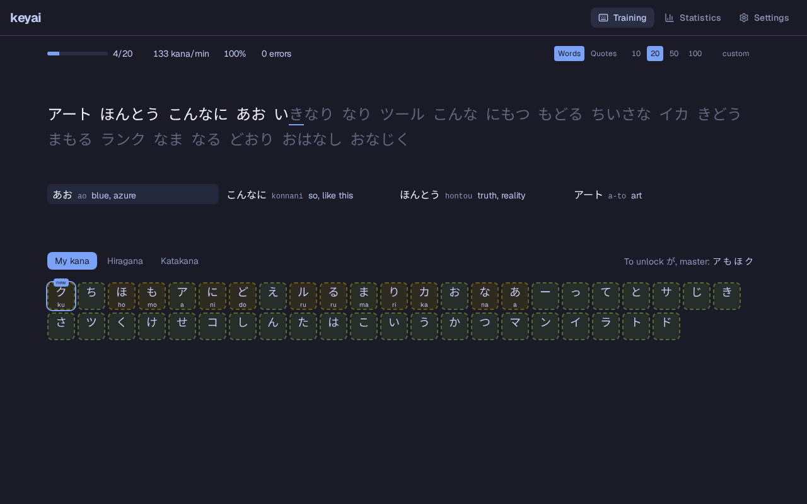
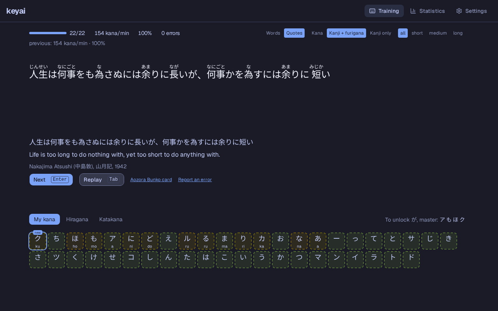
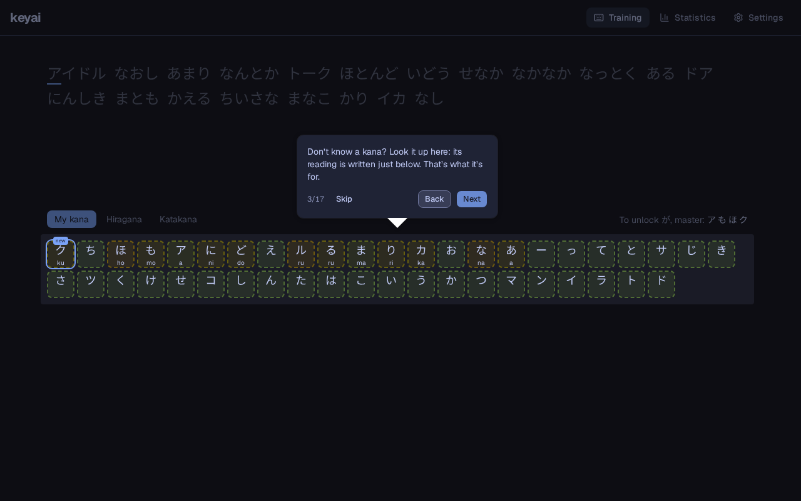

# keyai

**Learn to read Japanese by typing it.**

[](https://github.com/mumpkin/keyai/actions/workflows/ci.yml)
[](https://github.com/mumpkin/keyai/releases/latest)
[](./LICENSE)

keyai teaches complete beginners to read hiragana and katakana, the way
[Keybr](https://www.keybr.com/) teaches touch typing. You read frequent Japanese
words, type how they sound, and new kana unlock as you get faster and more
accurate. No account, no ads, and it works offline.

**[Try it on keyai.cat](https://keyai.cat/)** · [Download for Windows or Linux](https://github.com/mumpkin/keyai/releases/latest)



## Features

- **Learn by doing.** Kana unlock one at a time, in the order that opens the most
  frequent words, with hiragana and katakana side by side.
- **2,720 frequent words**, each with a translation in French or English and a
  card with its kanji, other meanings and grammar notes.
- **Forgiving romaji.** Hepburn is shown, and common spellings are accepted
  (`shi` or `si`).
- **Natural writing.** Words follow each other without typing a space.
- **Quote mode.** 100 quotes from Japanese literature, in kana, in kanji with
  furigana, or in kanji alone, with their translation and source.
- **Anki export.** Set words aside from their card and take them to Anki.
- **Statistics** on your speed, accuracy and progress for each kana.
- **A guided tour** at the first launch.
- **Yours.** Progress stays on your device, with export and import. Available on
  the web, as an installable app for phones, and for Windows and Linux. In French
  and English, with light and dark themes.





## Feedback

keyai is a young project, and your reports make it better:

- **A bug?** Use the link in Settings, About, or
  [open an issue](https://github.com/mumpkin/keyai/issues/new?template=bug.yml).
- **A wrong translation?** Use the link in the word card, or
  [report it](https://github.com/mumpkin/keyai/issues/new?template=translation.yml).
  Many translations and readings were not reviewed by a native speaker.

Like the project? You can [buy me a coffee](https://buymeacoffee.com/mumpkin).

## Development

Requires Node.js 24 or later and pnpm. The desktop app also needs Rust and the
[Tauri prerequisites](https://v2.tauri.app/start/prerequisites/).

```bash
pnpm install
pnpm dev          # web app on http://localhost:1420
pnpm dev:tauri    # desktop app
pnpm test         # unit tests
pnpm test:e2e     # end-to-end tests
```

The code is a pnpm monorepo: a pure TypeScript engine (`packages/core`), the
vocabulary and quotes (`packages/vocab`), and the React and Tauri app
(`apps/app`).

- [Contributing](./CONTRIBUTING.md)
- [Functional specification](./docs/functional-specification.md)
- [Functional design](./docs/functional-design.md)
- [Architecture](./docs/architecture.md)
- [Technical choices](./docs/technical-choices.md)
- [Changelog](./CHANGELOG.md)

## License

The source code is released under the [MIT License](./LICENSE).

The vocabulary, the word cards, and the translations and readings of the quotes
are released under
[Creative Commons Attribution-ShareAlike 4.0](https://creativecommons.org/licenses/by-sa/4.0/),
and derive from:

- [JMdict](https://www.edrdg.org/wiki/index.php/JMdict-EDICT_Dictionary_Project),
  property of the
  [Electronic Dictionary Research and Development Group](https://www.edrdg.org/),
  used in conformance with the Group's
  [licence](https://www.edrdg.org/edrdg/licence.html)
- [wordfreq](https://github.com/rspeer/wordfreq) by Robyn Speer

The quotes come from [Aozora Bunko](https://www.aozora.gr.jp/), from works out of
copyright there: see [their rules](./packages/vocab/data/quotes.md).
